# Automatic Airsoft Video Machine

Heart rate, GPS route, shots and story cards on your airsoft helmet-cam videos — a live HUD, a multitrack editor,
cards and titles, and a finished movie out.

**Download page:** https://uusitalo.github.io/airsoft-video-machine/

| | Latest | Needs |
|---|---|---|
| Windows | [Releases](../../releases) (tags `windows-v…`) | Windows 10/11 64-bit, nothing to install |
| Mac | [Releases](../../releases) (tags `mac-v…`) | macOS 14+, Apple silicon |
| Linux | [Releases](../../releases) (tags `linux-v…`) | 64-bit Linux, FFmpeg (`sudo apt install ffmpeg`) |

Projects are the same format on both: a project made on a Mac opens on Windows and the other way round.

<!-- avm-previews:start -->
## What is it?

**Automatic Airsoft Video Machine (AVM)** turns your airsoft helmet-cam or chest-cam footage into a finished game movie. It puts your **heart rate, GPS route, map, shots and hits** on the video as a live HUD. You can add your **friends' cameras**, **story cards**, **titles**, **subtitles**, **music** and **effects**, then export a movie, a vertical Reel or short clips.

It is a full video editor made for airsoft games. Most of the work is done by the app: it finds your shots in the sound, lines up your friends' videos, writes the subtitles and makes a first edit. Everything runs on your own computer, and nothing is uploaded unless you publish it.

There are two apps that read the same projects:

- **AVM Swift** for Mac (Apple silicon, macOS 14+).
- **AVM** for Windows and Linux.

A project made on one opens on the other. Features marked *(Mac)* are only in the Mac app so far.

## Everything it does

### Your data on the video: the HUD
- **Heart rate and route** come from an Apple Health export, from GPX, TCX or CSV files (Garmin, Polar, Suunto, Strava…), or from your watch's workout. A route without times is spread over the filming time.
- **Shown on the picture:** heart rate with zones and a graph, the map with your route walked so far, speed, distance, the clock and shots fired. *(Mac)* Health meters are shown too.
- **Many HUD themes, each with its own layout:**
  - The classic ones: bold, sport, terminal, gauge, glass, minimal, tactical and neon.
  - The Pro family.
  - The **Airsoft HUD**: a satellite map with the field you drew, your team's badge turning in 3D, and a **Doom-style face** that reacts to the game. The face can be drawn or made from your own selfies, and you can place and size it anywhere.
- **40+ game styles** (shooter, royale, retro, cinema, field and more) draw their own HUD, menus, titles, transitions and shot marks.
- **When you are hit**, the heartbeat flatlines with a heart monitor and a long beep.
- **Per piece:** the HUD can be turned off or given another theme for any piece of the video.

### Friends' cameras
- **Friends' videos on Video 2**, lined up by the clock or automatically **by sound**. The sync is exact even when a camera's clock is wrong by hours, and it stays in sync when you trim, move or split your own pieces.
- **Ways to show their camera:**
  - Picture-in-picture, with keyframes to move it.
  - Side by side (split screen).
  - Switching to their camera with a transition.
  - Cards made from their picture.
- **Each friend gets their own tracks** on the timeline under their name: video, sound, subtitles, cards and titles.
- **Whose video it is:** each friend's picture and name sit on their video, in any corner or anywhere you like.
- **Their route and heart rate** can be on your HUD: a squad list, their dots on your map, and their own hits.
- **Player profiles** (`.avmplayer`) share your name, colour, picture, Doom faces and gear with friends.

### Editing: the Multitrack timeline
- **Tracks:** Video 1, Video 2, Cards, Titles, Subtitles, Friends' subs, Music, Narration, Shots, Events and Heart rate.
- **Moving and cutting:**
  - Cut, trim, split and ripple, or place pieces freely.
  - Magnetic edges, box selection, moving many items at once.
  - Skimming, and a live preview with sound.
- **Undo, saving and shortcuts:**
  - Undo, saved edit versions, and automatic snapshots.
  - Keyboard shortcut sets: AVM's own, Final Cut Pro's or DaVinci Resolve's.
- **Edit page:** one clip at a time. Cut it, and mark shots and hits on its sound strip.
- **Storyboard:** the movie as cards you drag into order, plus a "clip movie" of the best parts.
- **Auto edit:** makes a first edit by itself. *(Mac)* It can let an on-device AI look at the moments (Apple Intelligence or an Ollama vision model).
- **Beat edit:** cuts the video to the beat of a song. *(Mac)* A **music video** maker adds the lyrics.
- **Speed:** slow motion that returns to normal, instant replays, rewinds, speed ramps and stutters.
- **Looks and colour:**
  - Looks and colour grades, `.cube` LUTs, the cinema look (glow, grain, vignette, bars) and matched colours between cameras.
  - Steadying, and slow zooms (Ken Burns).
- **Camera effects:** shake, breathing, fog, smoke, rain, mud, film burn, anamorphic flares, sun rays, heat haze and light leaks.
- **Transitions:**
  - Dissolves and wipes.
  - Luma melt, lens flare, prism, warp, film roll, cube, ripple.
  - **Team-logo transitions:** logo, smoke logo, fire logo, burning logo and logo on fire.
- **Beat effects:** flashes, zooms and shakes on the music's beats.

### Cards and titles
- **Card families:** story, game, war, funny and generated cards; intro, game mode, stats and end cards; credits.
- **Motion cards** cut you out of the video (freeze frames, posters, callouts, pop-ups, stop motion).
- **Game cards:**
  - **Game menu cards**, loadout cards from photos of your own gear (with a gear editor that removes the background), team logos and 3D logos.
  - **Maps:** the briefing map, a tactical map and a 3D flyover of your route, from the field you planned on the Map page.
  - **Radio call:** walkie-talkie sound, static and radio subtitles.
  - **Heartbeat:** your live heart rate.
- **Drawn tech cards:**
  - **Gun teardown:** a gun taken apart, with what was wrong and the fix.
  - **Chronograph:** a reading with the BB's flight.
  - **HPA:** how the air gets to the BB.
  - **Kit:** your kit laid out piece by piece.
- **"Previously" and archive cards** use your earlier videos from the same place.
- **Titles** come in many styles. Every game style draws cards and titles its own way.
- **Coloured icons** on the inspector's sections show where each part starts. *(Mac)*

### Sound, speech and subtitles
- **Shots found from the sound** of your clips and counted from your magazine: weapon changes, reloads and ammo on the HUD.
- **Game events:** objectives, mission updates and hits, as they happen. A game log can be imported.
- **Speech to text** with Whisper on the graphics chip, or Apple's recognizer. *(Mac)*
  - **English subtitles** are made by an AI on your own Mac (an Ollama model or Apple Intelligence), or by Whisper itself.
  - Friends' lines show in their own colours with their names.
- **Subtitle looks:** classic bands, styled ones per game style, and word-by-word looks (clean, karaoke, minimal, bold).
- **Saved with the movie:** subtitles go into the exported movie as tracks you can switch on and off, plus `.srt` files.
- **Narration:** text to speech with many voices. The game sound ducks under the voice.
- **Music:** songs on the timeline with fades, and ducking under narration.

### Game day: fields, games and players
- **kuulaportti.fi:** the day's game is found by place and time, with the players, factions, your game history and statistics.
- **Weather:** from the forecast archive, or from your watch's workout.
- **Map page (field planner):** draw the field with areas, bases, flags, routes, spawn points and radii.
  - Teams, game modes and a heat map of where you went.
  - Share and import fields (`.aavmfield`, GeoJSON, KML, GPX).
- **Airsoft fields in Finland:** a map of the clubs' fields is shown below.

### Your videos: the Media page
- **All your videos** from your folders, drives and NAS, grouped by day, event, month or folder, or shown on a map.
  - Details found from the files: camera, place and length.
  - Skimming previews.
- **Smoother editing:** smooth-play copies (proxies), and the camera's own low-res files (`.LRF`) used when they match.
- **Housekeeping:**
  - A copy to the NAS after import. *(Mac)*
  - Finding moved or missing clips.
  - A project's disk use.

### Export and share
- **The movie** in your clips' own size and frame rate, up to 4K, using your graphics card's encoder (NVENC, Quick Sync, AMF, VAAPI, Apple HEVC).
- **Vertical Reels (9:16)** that follow the action or track an area. *(Mac)*
- **Short clips:** of one piece, or of many at once.
- **Thumbnails, YouTube publishing and chapters.** *(Mac)*
- **Updates:** the apps update themselves from this page's Releases.

### Mac extras
- **Phone remote:** control the timeline from your phone and start jobs (export, auto edit, subtitles, finding people and shots). It also works with Siri shortcuts.
- **Apple Watch marks:** tap your watch during the game and the moment is starred on the timeline.
- **An activity badge** shows everything running in the background, with a stop button.

## Example

Made by the app itself (AVM Windows and Linux 1.6.88 / AVM Swift 1.6.88) from one short test clip, with a made-up route and heart rate.

[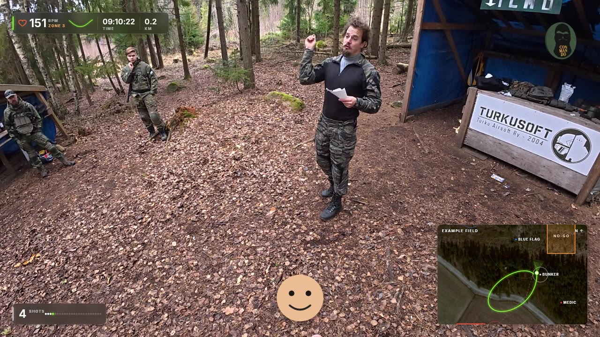](docs/previews/example-game.mp4)

[▶ The example film (MP4, 35 s)](docs/previews/example-game.mp4)

**Airsoft HUD:** heart rate, time, distance and shots, the satellite map with the field you drew on the Map page, your team's badge turning in the corner (its 3D model when the team has one) and a face that reacts to the game - your own face pictures, or this drawn one. When you are hit, the heartbeat flatlines.

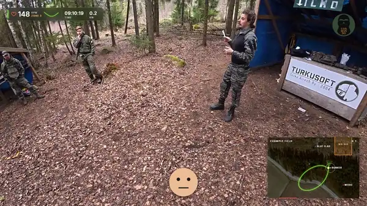

| Briefing map card (the plan from the Map page) | Gun teardown card (what was wrong, and the fix) |
|:---:|:---:|
| 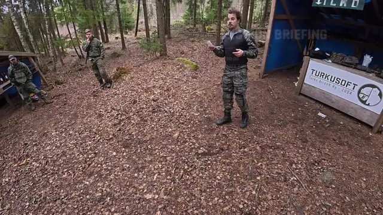 | 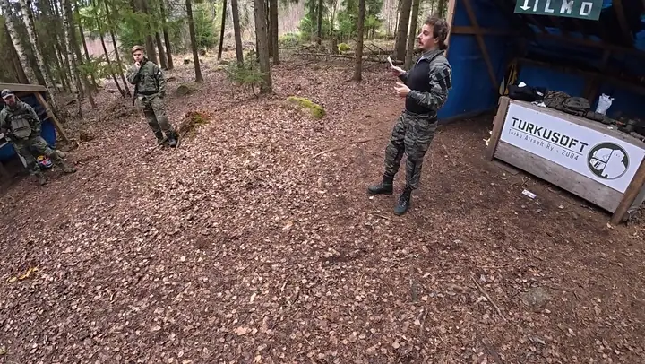 |

**Drawn cards** (1.6.88): a chronograph reading with the BB's flight, how an HPA gun works, and your kit laid out piece by piece - set the numbers and the gun on the card.

| Chrono and the BB's flight | HPA: how the air gets to the BB |
|:---:|:---:|
| 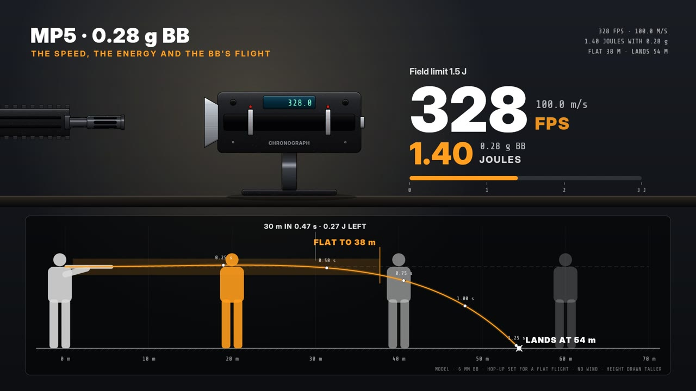 | 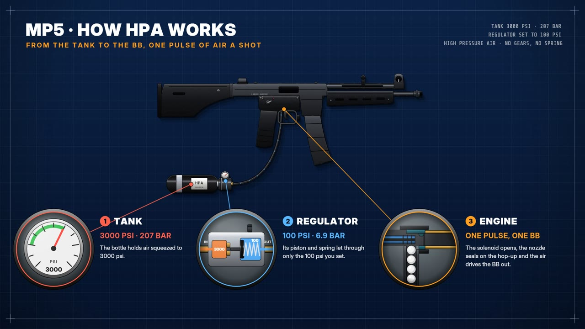 |

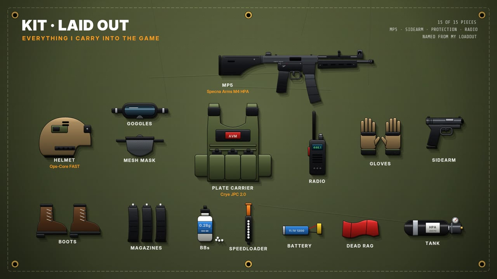

[▶ The three cards as a video (MP4, 27 s)](docs/previews/new-cards.mp4)

**Game events and subtitles:** mission updates, objectives, weapon changes and reloads as they happen, your shots counted from the magazine, and what was said as subtitles (also saved as an .srt file with the movie). Every game style draws them its own way.

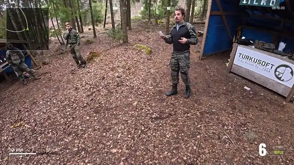

## The app

| Timeline | Storyboard |
|:---:|:---:|
| 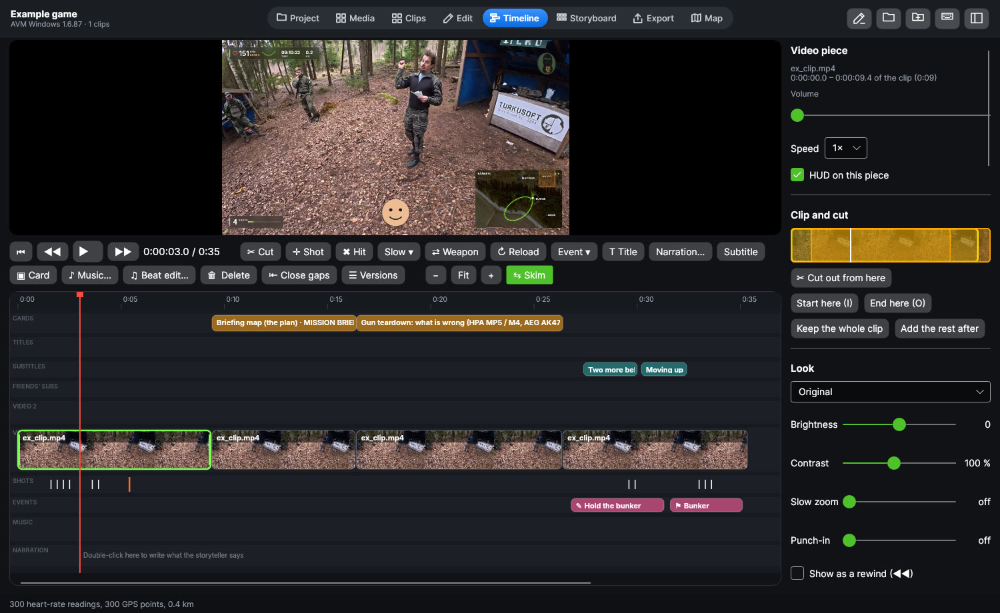 | 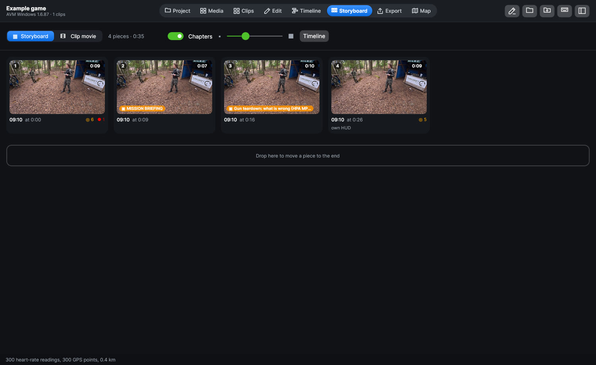 |
| **Map page: plan the field** | **Edit page: one clip, its cut and its shots** |
| 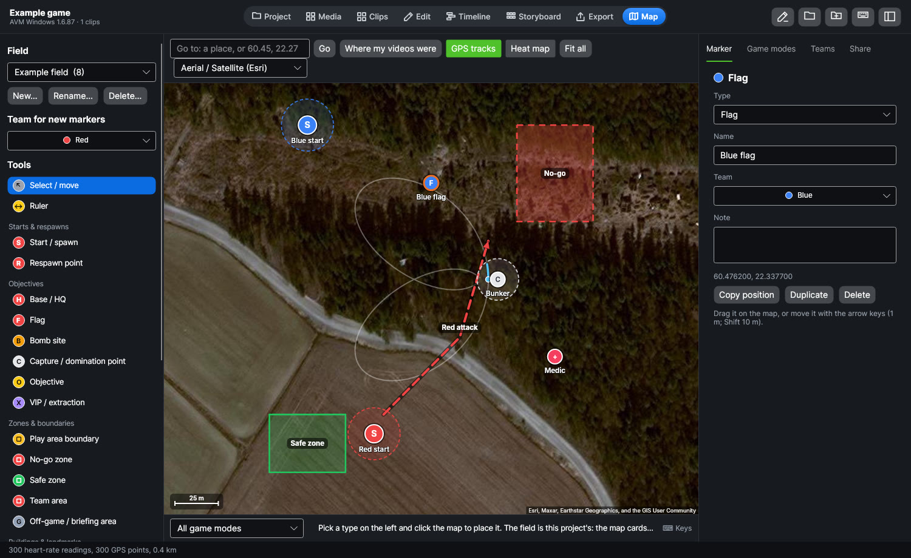 | 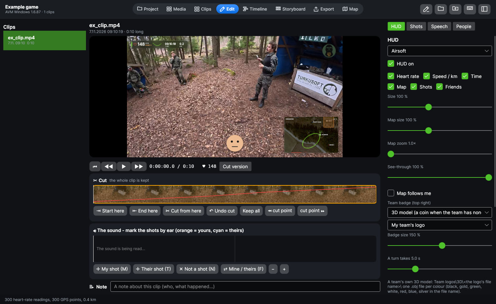 |

**Cards on the timeline** (here the gun teardown card, with its gun and problem pickers):

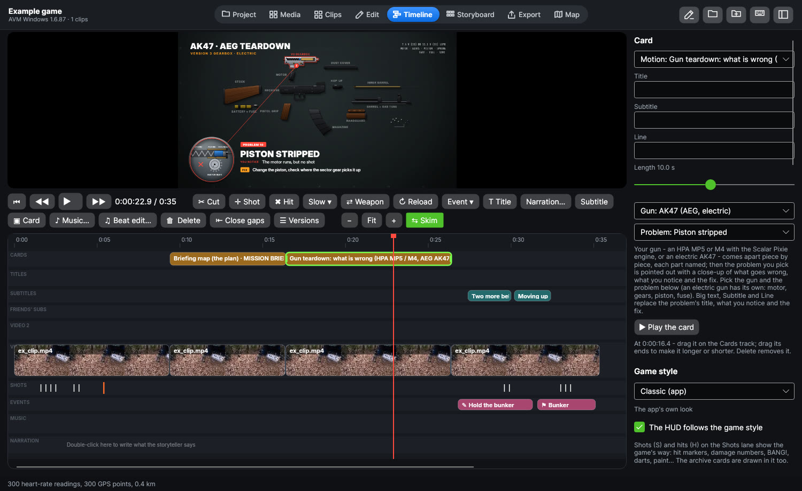

## Airsoft fields in Finland

57 Finnish airsoft fields with club games in the last two years, collected from kuulaportti.fi (11 Nov 2026). Drag and zoom the map, and click a pin for the fee, power limits and the field's kuulaportti page. Red = indoor / CQB, green = outdoor, orange = big events and milsims; a big pin = 30 or more games.

57 suomalaista airsoft-pelialuetta, joilla seurat pelasivat kahden viime vuoden aikana (Kuulaportista 11.11.2026). Klikkaa nastaa: hinta, tehorajat ja alueen Kuulaportti-sivu. Punainen = sisä / CQB, vihreä = ulkoalue, oranssi = isot tapahtumat ja milsimit.

```geojson
{"type":"FeatureCollection","features":[{"type":"Feature","geometry":{"type":"Point","coordinates":[24.68681,60.47588]},"properties":{"marker-color":"#d62728","marker-symbol":"building","marker-size":"large","Field":"Vauhtifarmi","Town":"Nurmijärvi","Club":"Uudenmaan Airsoft ry","Terrain":"34 buildings + forest (CQB village)","Maasto":"34 rakennusta + metsä (CQB-kylä)","Games in 2 years / Pelejä 2 v":83,"Fee (guest / member)":"13 / 8 €","Hinta (vieras / jäsen)":"13 / 8 €","Power limits":"1.7 J in the cold season; no pyro","Tehorajat":"1,7 J kylmällä kaudella; ei pyroja","kuulaportti":"https://kuulaportti.fi/index.php?page=location_profile&id=78"}},{"type":"Feature","geometry":{"type":"Point","coordinates":[24.83217,60.25042]},"properties":{"marker-color":"#2ca02c","marker-symbol":"park","marker-size":"large","Field":"Sissos Konala","Town":"Espoo","Club":"Uudenmaan Airsoft ry","Terrain":"Built forest field","Maasto":"Rakennettu metsäkenttä","Games in 2 years / Pelejä 2 v":32,"Fee (guest / member)":"8 / 3 €","Hinta (vieras / jäsen)":"8 / 3 €","Power limits":"1.4 J, semi only","Tehorajat":"1,4 J, vain kertatuli","kuulaportti":"https://kuulaportti.fi/index.php?page=location_profile&id=38"}},{"type":"Feature","geometry":{"type":"Point","coordinates":[24.87656,60.26904]},"properties":{"marker-color":"#d62728","marker-symbol":"building","marker-size":"medium","Field":"The Back Alley","Town":"Vantaa","Club":"Uudenmaan Airsoft ry","Terrain":"Indoor CQB","Maasto":"Sisä-CQB","Games in 2 years / Pelejä 2 v":16,"Fee (guest / member)":"18 / 13 €","Hinta (vieras / jäsen)":"18 / 13 €","Power limits":"1 J, semi only","Tehorajat":"1 J, vain kertatuli","kuulaportti":"https://kuulaportti.fi/index.php?page=location_profile&id=102"}},{"type":"Feature","geometry":{"type":"Point","coordinates":[24.9089,60.39052]},"properties":{"marker-color":"#2ca02c","marker-symbol":"park","marker-size":"medium","Field":"Veikkola, Metsä","Town":"Tuusula","Club":"Järvenpää-airsoft ry","Terrain":"Forest","Maasto":"Metsä","Games in 2 years / Pelejä 2 v":17,"Fee (guest / member)":"5 € / free","Hinta (vieras / jäsen)":"5 € / ilmainen","Power limits":"1.7 J; SMG 1.2 J; MG 2 J; DMR 2.25 J; bolt 3 J","Tehorajat":"1,7 J; konepistooli 1,2 J; KK 2 J; DMR 2,25 J; pultti 3 J","kuulaportti":"https://kuulaportti.fi/index.php?page=location_profile&id=48"}},{"type":"Feature","geometry":{"type":"Point","coordinates":[24.91556,60.39115]},"properties":{"marker-color":"#d62728","marker-symbol":"building","marker-size":"medium","Field":"Veikkola, Piha","Town":"Tuusula","Club":"Järvenpää-airsoft ry","Terrain":"Yard and buildings","Maasto":"Piha ja rakennukset","Games in 2 years / Pelejä 2 v":8,"Fee (guest / member)":"5 € / free","Hinta (vieras / jäsen)":"5 € / ilmainen","Power limits":"as Veikkola Metsä","Tehorajat":"kuten Veikkola, Metsä","kuulaportti":"https://kuulaportti.fi/index.php?page=location_profile&id=47"}},{"type":"Feature","geometry":{"type":"Point","coordinates":[25.61358,60.39339]},"properties":{"marker-color":"#2ca02c","marker-symbol":"park","marker-size":"large","Field":"Kuninkaanportin pelialue","Town":"Porvoo","Club":"PSAY","Terrain":"Forest","Maasto":"Metsä","Games in 2 years / Pelejä 2 v":41,"Fee (guest / member)":"2 €","Hinta (vieras / jäsen)":"2 €","Power limits":"–","Tehorajat":"–","kuulaportti":"https://kuulaportti.fi/index.php?page=location_profile&id=31"}},{"type":"Feature","geometry":{"type":"Point","coordinates":[25.59305,60.42704]},"properties":{"marker-color":"#2ca02c","marker-symbol":"park","marker-size":"medium","Field":"Saksala","Town":"Porvoo","Club":"PSAY","Terrain":"Forest","Maasto":"Metsä","Games in 2 years / Pelejä 2 v":3,"Fee (guest / member)":"2 €","Hinta (vieras / jäsen)":"2 €","Power limits":"–","Tehorajat":"–","kuulaportti":"https://kuulaportti.fi/index.php?page=location_profile&id=104"}},{"type":"Feature","geometry":{"type":"Point","coordinates":[24.56314,60.56584]},"properties":{"marker-color":"#ff7f0e","marker-symbol":"star","marker-size":"medium","Field":"Vihtijärvi","Town":"Vihti","Club":"Ehasa","Terrain":"Big forest area (events)","Maasto":"Iso metsäalue (tapahtumat)","Games in 2 years / Pelejä 2 v":12,"Fee (guest / member)":"30–60 € events","Hinta (vieras / jäsen)":"30–60 € tapahtumat","Power limits":"event rules","Tehorajat":"tapahtuman säännöt","kuulaportti":"https://kuulaportti.fi/index.php?page=location_profile&id=21"}},{"type":"Feature","geometry":{"type":"Point","coordinates":[25.49614,60.79538]},"properties":{"marker-color":"#2ca02c","marker-symbol":"park","marker-size":"medium","Field":"Henna","Town":"Orimattila","Club":"PäijätSoft","Terrain":"Outdoor","Maasto":"Ulkoalue","Games in 2 years / Pelejä 2 v":6,"Fee (guest / member)":"15 / 5 €","Hinta (vieras / jäsen)":"15 / 5 €","Power limits":"1.7 J; DMR 2.25 J; bolt 3 J","Tehorajat":"1,7 J; DMR 2,25 J; pultti 3 J","kuulaportti":"https://kuulaportti.fi/index.php?page=location_profile&id=120"}},{"type":"Feature","geometry":{"type":"Point","coordinates":[22.3376,60.47541]},"properties":{"marker-color":"#2ca02c","marker-symbol":"park","marker-size":"large","Field":"Häämäki","Town":"Kaarina","Club":"Turku Airsoft ry","Terrain":"Outdoor","Maasto":"Ulkoalue","Games in 2 years / Pelejä 2 v":65,"Fee (guest / member)":"5 € / free","Hinta (vieras / jäsen)":"5 € / ilmainen","Power limits":"Turkusoft rules; bio only","Tehorajat":"Turkusoftin säännöt; vain bio","kuulaportti":"https://kuulaportti.fi/index.php?page=location_profile&id=18"}},{"type":"Feature","geometry":{"type":"Point","coordinates":[22.17768,60.36131]},"properties":{"marker-color":"#2ca02c","marker-symbol":"park","marker-size":"medium","Field":"Kakskerta","Town":"Turku","Club":"Turku Airsoft ry","Terrain":"Outdoor","Maasto":"Ulkoalue","Games in 2 years / Pelejä 2 v":23,"Fee (guest / member)":"5 € / free","Hinta (vieras / jäsen)":"5 € / ilmainen","Power limits":"Turkusoft rules; bio only","Tehorajat":"Turkusoftin säännöt; vain bio","kuulaportti":"https://kuulaportti.fi/index.php?page=location_profile&id=15"}},{"type":"Feature","geometry":{"type":"Point","coordinates":[22.29665,60.48429]},"properties":{"marker-color":"#d62728","marker-symbol":"building","marker-size":"medium","Field":"Toimintaurheilukeskus Tiilitehdas","Town":"Turku","Club":"Turku Airsoft ry","Terrain":"Indoor","Maasto":"Sisäalue","Games in 2 years / Pelejä 2 v":17,"Fee (guest / member)":"20 / 10 €","Hinta (vieras / jäsen)":"20 / 10 €","Power limits":"1.2 J, semi only","Tehorajat":"1,2 J, vain kertatuli","kuulaportti":"https://kuulaportti.fi/index.php?page=location_profile&id=72"}},{"type":"Feature","geometry":{"type":"Point","coordinates":[23.29987,60.50427]},"properties":{"marker-color":"#2ca02c","marker-symbol":"park","marker-size":"large","Field":"Väljäkallio (Salosoft ry)","Town":"Salo","Club":"Salosoft Ry","Terrain":"Outdoor","Maasto":"Ulkoalue","Games in 2 years / Pelejä 2 v":47,"Fee (guest / member)":"–","Hinta (vieras / jäsen)":"–","Power limits":"Salosoft rules; bio BBs sold on site","Tehorajat":"Salosoftin säännöt; biokuulia myynnissä","kuulaportti":"https://kuulaportti.fi/index.php?page=location_profile&id=53"}},{"type":"Feature","geometry":{"type":"Point","coordinates":[23.05205,60.87114]},"properties":{"marker-color":"#2ca02c","marker-symbol":"park","marker-size":"large","Field":"Loimaan Pelikenttä","Town":"Loimaa","Club":"Loimaa Airsoft ry","Terrain":"Outdoor field","Maasto":"Ulkokenttä","Games in 2 years / Pelejä 2 v":46,"Fee (guest / member)":"3 € / free","Hinta (vieras / jäsen)":"3 € / ilmainen","Power limits":"Loimaa rules","Tehorajat":"Loimaan säännöt","kuulaportti":"https://kuulaportti.fi/index.php?page=location_profile&id=92"}},{"type":"Feature","geometry":{"type":"Point","coordinates":[22.88378,60.78338]},"properties":{"marker-color":"#2ca02c","marker-symbol":"park","marker-size":"medium","Field":"Mellilän Pelikenttä","Town":"Loimaa (Mellilä)","Club":"Loimaa Airsoft ry","Terrain":"Outdoor (forest)","Maasto":"Ulkoalue (metsä)","Games in 2 years / Pelejä 2 v":9,"Fee (guest / member)":"20 / 15 € (Autumnsiege)","Hinta (vieras / jäsen)":"20 / 15 € (Autumnsiege)","Power limits":"bio; airsoft pyro and smoke allowed","Tehorajat":"bio; airsoft-pyrot ja savut sallittu","kuulaportti":"https://kuulaportti.fi/index.php?page=location_profile&id=99"}},{"type":"Feature","geometry":{"type":"Point","coordinates":[22.10265,61.32377]},"properties":{"marker-color":"#d62728","marker-symbol":"building","marker-size":"large","Field":"Valimo","Town":"Harjavalta","Club":"Satakunnan Airsoft ry","Terrain":"Old foundry (indoor + yard)","Maasto":"Vanha valimo (sisä + piha)","Games in 2 years / Pelejä 2 v":31,"Fee (guest / member)":"5 €","Hinta (vieras / jäsen)":"5 €","Power limits":"Satasoft rules","Tehorajat":"Satasoftin säännöt","kuulaportti":"https://kuulaportti.fi/index.php?page=location_profile&id=46"}},{"type":"Feature","geometry":{"type":"Point","coordinates":[21.64106,61.51644]},"properties":{"marker-color":"#2ca02c","marker-symbol":"park","marker-size":"medium","Field":"KKR","Town":"Pori","Club":"Satakunnan Airsoft ry","Terrain":"Outdoor","Maasto":"Ulkoalue","Games in 2 years / Pelejä 2 v":19,"Fee (guest / member)":"5 €","Hinta (vieras / jäsen)":"5 €","Power limits":"Satasoft rules","Tehorajat":"Satasoftin säännöt","kuulaportti":"https://kuulaportti.fi/index.php?page=location_profile&id=44"}},{"type":"Feature","geometry":{"type":"Point","coordinates":[22.35552,61.82902]},"properties":{"marker-color":"#d62728","marker-symbol":"building","marker-size":"medium","Field":"Lohikko","Town":"Kankaanpää","Club":"Satakunnan Airsoft ry","Terrain":"4000 m² three-floor building + yard","Maasto":"4000 m², 3-kerroksinen rakennus + piha","Games in 2 years / Pelejä 2 v":13,"Fee (guest / member)":"5 €","Hinta (vieras / jäsen)":"5 €","Power limits":"inside 1.2 J; outside 1.7 J (15 m); DMR 2.5 J","Tehorajat":"sisällä 1,2 J; ulkona 1,7 J (15 m); DMR 2,5 J","kuulaportti":"https://kuulaportti.fi/index.php?page=location_profile&id=116"}},{"type":"Feature","geometry":{"type":"Point","coordinates":[21.71571,61.08573]},"properties":{"marker-color":"#2ca02c","marker-symbol":"park","marker-size":"medium","Field":"Kolla","Town":"Rauma","Club":"Satakunnan Airsoft ry","Terrain":"Outdoor","Maasto":"Ulkoalue","Games in 2 years / Pelejä 2 v":6,"Fee (guest / member)":"–","Hinta (vieras / jäsen)":"–","Power limits":"Satasoft rules","Tehorajat":"Satasoftin säännöt","kuulaportti":"https://kuulaportti.fi/index.php?page=location_profile&id=76"}},{"type":"Feature","geometry":{"type":"Point","coordinates":[22.08249,60.20993]},"properties":{"marker-color":"#ff7f0e","marker-symbol":"star","marker-size":"medium","Field":"Nauvo","Town":"Parainen","Club":"Valkyries","Terrain":"Archipelago (milsim)","Maasto":"Saaristo (milsim)","Games in 2 years / Pelejä 2 v":1,"Fee (guest / member)":"0–25 €","Hinta (vieras / jäsen)":"0–25 €","Power limits":"event rules","Tehorajat":"tapahtuman säännöt","kuulaportti":"https://kuulaportti.fi/index.php?page=location_profile&id=22"}},{"type":"Feature","geometry":{"type":"Point","coordinates":[23.8895,61.161]},"properties":{"marker-color":"#2ca02c","marker-symbol":"park","marker-size":"large","Field":"Ansarinkuja","Town":"Akaa","Club":"Akaasoft","Terrain":"Outdoor + night games","Maasto":"Ulkoalue + pimeäpelit","Games in 2 years / Pelejä 2 v":81,"Fee (guest / member)":"5 € own gear, 20 € rental","Hinta (vieras / jäsen)":"5 € omilla, 20 € vuokrakamoilla","Power limits":"Akaasoft rules","Tehorajat":"Akaasoftin säännöt","kuulaportti":"https://kuulaportti.fi/index.php?page=location_profile&id=81"}},{"type":"Feature","geometry":{"type":"Point","coordinates":[23.67588,61.15104]},"properties":{"marker-color":"#d62728","marker-symbol":"building","marker-size":"large","Field":"Kylmis","Town":"Akaa","Club":"Akaasoft","Terrain":"CQB (Kylmäkoski)","Maasto":"CQB (Kylmäkoski)","Games in 2 years / Pelejä 2 v":44,"Fee (guest / member)":"10–12 €","Hinta (vieras / jäsen)":"10–12 €","Power limits":"1.2 J, BB max 0.32 g","Tehorajat":"1,2 J, kuula enint. 0,32 g","kuulaportti":"https://kuulaportti.fi/index.php?page=location_profile&id=100"}},{"type":"Feature","geometry":{"type":"Point","coordinates":[23.5577,61.07793]},"properties":{"marker-color":"#d62728","marker-symbol":"building","marker-size":"medium","Field":"Erikoiskomennus Reikko Urjala","Town":"Urjala","Club":"Loimaa Airsoft ry","Terrain":"Indoor CQB (old care home)","Maasto":"Sisä-CQB (vanha vanhainkoti)","Games in 2 years / Pelejä 2 v":13,"Fee (guest / member)":"20 / 15 €","Hinta (vieras / jäsen)":"20 / 15 €","Power limits":"1.2 J, BB max 0.32 g","Tehorajat":"1,2 J, kuula enint. 0,32 g","kuulaportti":"https://kuulaportti.fi/index.php?page=location_profile&id=80"}},{"type":"Feature","geometry":{"type":"Point","coordinates":[24.10998,61.19207]},"properties":{"marker-color":"#2ca02c","marker-symbol":"park","marker-size":"large","Field":"Säres Center","Town":"Valkeakoski","Club":"Pirkanmaasoft ry","Terrain":"Outdoor centre with sauna","Maasto":"Ulkokeskus ja sauna","Games in 2 years / Pelejä 2 v":30,"Fee (guest / member)":"5 € / free","Hinta (vieras / jäsen)":"5 € / ilmainen","Power limits":"club rules","Tehorajat":"seuran säännöt","kuulaportti":"https://kuulaportti.fi/index.php?page=location_profile&id=20"}},{"type":"Feature","geometry":{"type":"Point","coordinates":[23.61669,61.63321]},"properties":{"marker-color":"#d62728","marker-symbol":"building","marker-size":"medium","Field":"Rate town","Town":"Ylöjärvi","Club":"Rate Ry","Terrain":"Town and lab buildings","Maasto":"Kylä- ja laboratoriorakennuksia","Games in 2 years / Pelejä 2 v":13,"Fee (guest / member)":"10–20 €","Hinta (vieras / jäsen)":"10–20 €","Power limits":"1.7 J; MG 2 J; DMR 2.25 J; bolt 3 J (night games)","Tehorajat":"1,7 J; KK 2 J; DMR 2,25 J; pultti 3 J (pimeäpelit)","kuulaportti":"https://kuulaportti.fi/index.php?page=location_profile&id=105"}},{"type":"Feature","geometry":{"type":"Point","coordinates":[23.76062,61.45368]},"properties":{"marker-color":"#d62728","marker-symbol":"building","marker-size":"medium","Field":"Us Eagle Arena","Town":"Tampere","Club":"Rate Ry","Terrain":"Indoor arena","Maasto":"Sisäareena","Games in 2 years / Pelejä 2 v":10,"Fee (guest / member)":"8–10 €","Hinta (vieras / jäsen)":"8–10 €","Power limits":"1.2 J, semi only","Tehorajat":"1,2 J, vain kertatuli","kuulaportti":"https://kuulaportti.fi/index.php?page=location_profile&id=101"}},{"type":"Feature","geometry":{"type":"Point","coordinates":[23.7662,61.3576]},"properties":{"marker-color":"#2ca02c","marker-symbol":"park","marker-size":"medium","Field":"Jättömaa","Town":"Lempäälä","Club":"Pirkanmaasoft ry","Terrain":"Outdoor","Maasto":"Ulkoalue","Games in 2 years / Pelejä 2 v":6,"Fee (guest / member)":"5 € / free","Hinta (vieras / jäsen)":"5 € / ilmainen","Power limits":"pistol days 1.2 J","Tehorajat":"pistoolipäivät 1,2 J","kuulaportti":"https://kuulaportti.fi/index.php?page=location_profile&id=40"}},{"type":"Feature","geometry":{"type":"Point","coordinates":[23.05492,61.77236]},"properties":{"marker-color":"#d62728","marker-symbol":"building","marker-size":"medium","Field":"Kauppaoppilaitos","Town":"Ikaalinen","Club":"Pirkanmaasoft ry","Terrain":"School building, many floors","Maasto":"Koulurakennus, monta kerrosta","Games in 2 years / Pelejä 2 v":3,"Fee (guest / member)":"5 € / free","Hinta (vieras / jäsen)":"5 € / ilmainen","Power limits":"1.5 J, semi only","Tehorajat":"1,5 J, vain kertatuli","kuulaportti":"https://kuulaportti.fi/index.php?page=location_profile&id=119"}},{"type":"Feature","geometry":{"type":"Point","coordinates":[22.94598,61.96887]},"properties":{"marker-color":"#2ca02c","marker-symbol":"park","marker-size":"medium","Field":"Lapinnevan Pelialue","Town":"Ikaalinen","Club":"Parkano Airsoft Ry","Terrain":"Outdoor","Maasto":"Ulkoalue","Games in 2 years / Pelejä 2 v":17,"Fee (guest / member)":"–","Hinta (vieras / jäsen)":"–","Power limits":"Parkano rules","Tehorajat":"Parkanon säännöt","kuulaportti":"https://kuulaportti.fi/index.php?page=location_profile&id=103"}},{"type":"Feature","geometry":{"type":"Point","coordinates":[23.11476,61.95901]},"properties":{"marker-color":"#2ca02c","marker-symbol":"park","marker-size":"medium","Field":"Poikkeusharjun Pelialue","Town":"Parkano","Club":"Parkano Airsoft Ry","Terrain":"Outdoor","Maasto":"Ulkoalue","Games in 2 years / Pelejä 2 v":11,"Fee (guest / member)":"–","Hinta (vieras / jäsen)":"–","Power limits":"Parkano rules","Tehorajat":"Parkanon säännöt","kuulaportti":"https://kuulaportti.fi/index.php?page=location_profile&id=112"}},{"type":"Feature","geometry":{"type":"Point","coordinates":[24.3835,61.01198]},"properties":{"marker-color":"#2ca02c","marker-symbol":"park","marker-size":"large","Field":"Hiihtomaa","Town":"Hämeenlinna","Club":"Linnasoft ry","Terrain":"Ski slope area","Maasto":"Laskettelurinteen alue","Games in 2 years / Pelejä 2 v":32,"Fee (guest / member)":"none (weekday)","Hinta (vieras / jäsen)":"ei maksua (arki-ilta)","Power limits":"Linnasoft rules","Tehorajat":"Linnasoftin säännöt","kuulaportti":"https://kuulaportti.fi/index.php?page=location_profile&id=16"}},{"type":"Feature","geometry":{"type":"Point","coordinates":[24.75164,61.15437]},"properties":{"marker-color":"#ff7f0e","marker-symbol":"star","marker-size":"medium","Field":"Tuuloksen Juoksuhaudat","Town":"Hämeenlinna","Club":"TGW AIRSOFT","Terrain":"Trenches (WW2 games)","Maasto":"Juoksuhaudat (WW2-pelit)","Games in 2 years / Pelejä 2 v":2,"Fee (guest / member)":"5 €","Hinta (vieras / jäsen)":"5 €","Power limits":"event rules","Tehorajat":"tapahtuman säännöt","kuulaportti":"https://kuulaportti.fi/index.php?page=location_profile&id=65"}},{"type":"Feature","geometry":{"type":"Point","coordinates":[25.16886,61.81636]},"properties":{"marker-color":"#2ca02c","marker-symbol":"park","marker-size":"large","Field":"Jämsän Paintball","Town":"Jämsä","Club":"Keski-Suomen Airsoft RY","Terrain":"Paintball field","Maasto":"Paintball-kenttä","Games in 2 years / Pelejä 2 v":37,"Fee (guest / member)":"2 € / free","Hinta (vieras / jäsen)":"2 € / ilmainen","Power limits":"auto 1.6 J; semi 2.25 J; bolt 3 J","Tehorajat":"sarja 1,6 J; kerta 2,25 J; pultti 3 J","kuulaportti":"https://kuulaportti.fi/index.php?page=location_profile&id=51"}},{"type":"Feature","geometry":{"type":"Point","coordinates":[24.76626,61.8621]},"properties":{"marker-color":"#ff7f0e","marker-symbol":"star","marker-size":"medium","Field":"Halli","Town":"Jämsä","Club":"Ehasa","Terrain":"Military training area (Battlegroup)","Maasto":"Harjoitusalue (Battlegroup)","Games in 2 years / Pelejä 2 v":2,"Fee (guest / member)":"from 114 €, civilians 39 €","Hinta (vieras / jäsen)":"alk. 114 €, siviilit 39 €","Power limits":"event rules","Tehorajat":"tapahtuman säännöt","kuulaportti":"https://kuulaportti.fi/index.php?page=location_profile&id=84"}},{"type":"Feature","geometry":{"type":"Point","coordinates":[25.75584,62.13002]},"properties":{"marker-color":"#d62728","marker-symbol":"building","marker-size":"medium","Field":"Lehtisaaren vanha yläkoulu","Town":"Jyväskylä","Club":"Keski-Suomen Airsoft RY","Terrain":"Old school (indoor)","Maasto":"Vanha koulu (sisä)","Games in 2 years / Pelejä 2 v":9,"Fee (guest / member)":"5 €","Hinta (vieras / jäsen)":"5 €","Power limits":"1.2 J, semi only","Tehorajat":"1,2 J, vain kertatuli","kuulaportti":"https://kuulaportti.fi/index.php?page=location_profile&id=111"}},{"type":"Feature","geometry":{"type":"Point","coordinates":[25.88419,62.57149]},"properties":{"marker-color":"#d62728","marker-symbol":"building","marker-size":"medium","Field":"Sisä-Suomen sairaala","Town":"Äänekoski","Club":"Keski-Suomen Airsoft RY","Terrain":"Old hospital, 13 ha","Maasto":"Vanha sairaala, 13 ha","Games in 2 years / Pelejä 2 v":7,"Fee (guest / member)":"15 / 10 €","Hinta (vieras / jäsen)":"15 / 10 €","Power limits":"club rules, every gun chronographed","Tehorajat":"seuran säännöt, kaikki aseet kronotetaan","kuulaportti":"https://kuulaportti.fi/index.php?page=location_profile&id=122"}},{"type":"Feature","geometry":{"type":"Point","coordinates":[26.71274,60.78993]},"properties":{"marker-color":"#2ca02c","marker-symbol":"park","marker-size":"large","Field":"Ummeljoki","Town":"Kouvola","Club":"KARY","Terrain":"Gravel pit","Maasto":"Soramonttu","Games in 2 years / Pelejä 2 v":56,"Fee (guest / member)":"5 €","Hinta (vieras / jäsen)":"5 €","Power limits":"bio only (lifetime ban otherwise)","Tehorajat":"vain bio (muuten elinikäinen pelikielto)","kuulaportti":"https://kuulaportti.fi/index.php?page=location_profile&id=17"}},{"type":"Feature","geometry":{"type":"Point","coordinates":[28.65125,61.17505]},"properties":{"marker-color":"#d62728","marker-symbol":"building","marker-size":"medium","Field":"Saimaa Airsoft ry","Town":"Lappeenranta","Club":"Saimaa Airsoft ry","Terrain":"Hotel building (junior games)","Maasto":"Hotellirakennus (junnupelit)","Games in 2 years / Pelejä 2 v":16,"Fee (guest / member)":"free (juniors)","Hinta (vieras / jäsen)":"ilmainen (junnut)","Power limits":"1.4 J; bio","Tehorajat":"1,4 J; bio","kuulaportti":"https://kuulaportti.fi/index.php?page=location_profile&id=94"}},{"type":"Feature","geometry":{"type":"Point","coordinates":[28.94869,61.86359]},"properties":{"marker-color":"#d62728","marker-symbol":"building","marker-size":"large","Field":"Haka","Town":"Savonlinna","Club":"Savonlinna Airsoft Ry","Terrain":"Indoor / yard","Maasto":"Sisä / piha","Games in 2 years / Pelejä 2 v":30,"Fee (guest / member)":"4 / 2 €","Hinta (vieras / jäsen)":"4 / 2 €","Power limits":"1.2 J","Tehorajat":"1,2 J","kuulaportti":"https://kuulaportti.fi/index.php?page=location_profile&id=106"}},{"type":"Feature","geometry":{"type":"Point","coordinates":[28.93523,61.86277]},"properties":{"marker-color":"#2ca02c","marker-symbol":"park","marker-size":"medium","Field":"Tuokkolan pelialue","Town":"Savonlinna","Club":"Savonlinna Airsoft Ry","Terrain":"Outdoor","Maasto":"Ulkoalue","Games in 2 years / Pelejä 2 v":22,"Fee (guest / member)":"4 / 2 €","Hinta (vieras / jäsen)":"4 / 2 €","Power limits":"1.2 J","Tehorajat":"1,2 J","kuulaportti":"https://kuulaportti.fi/index.php?page=location_profile&id=77"}},{"type":"Feature","geometry":{"type":"Point","coordinates":[28.81631,61.97494]},"properties":{"marker-color":"#2ca02c","marker-symbol":"park","marker-size":"medium","Field":"Varpala","Town":"Savonlinna","Club":"Savonlinna Airsoft Ry","Terrain":"Sand pit","Maasto":"Hiekkamonttu","Games in 2 years / Pelejä 2 v":16,"Fee (guest / member)":"4 / 2 €","Hinta (vieras / jäsen)":"4 / 2 €","Power limits":"club rules, full auto allowed","Tehorajat":"seuran säännöt, sarjatuli sallittu","kuulaportti":"https://kuulaportti.fi/index.php?page=location_profile&id=96"}},{"type":"Feature","geometry":{"type":"Point","coordinates":[27.82649,62.18012]},"properties":{"marker-color":"#d62728","marker-symbol":"building","marker-size":"medium","Field":"Joroisten vanha kunnanvirasto","Town":"Joroinen","Club":"JoroSoft","Terrain":"Old municipal office","Maasto":"Vanha kunnanvirasto","Games in 2 years / Pelejä 2 v":19,"Fee (guest / member)":"0–13 €","Hinta (vieras / jäsen)":"0–13 €","Power limits":"club rules","Tehorajat":"seuran säännöt","kuulaportti":"https://kuulaportti.fi/index.php?page=location_profile&id=117"}},{"type":"Feature","geometry":{"type":"Point","coordinates":[29.82033,62.73358]},"properties":{"marker-color":"#d62728","marker-symbol":"building","marker-size":"large","Field":"Kontiorannan kasarmi 4","Town":"Kontiolahti","Club":"Joensuu Airsoft Ry","Terrain":"Barracks building","Maasto":"Kasarmirakennus","Games in 2 years / Pelejä 2 v":32,"Fee (guest / member)":"5 / 2 €","Hinta (vieras / jäsen)":"5 / 2 €","Power limits":"1.2 J","Tehorajat":"1,2 J","kuulaportti":"https://kuulaportti.fi/index.php?page=location_profile&id=63"}},{"type":"Feature","geometry":{"type":"Point","coordinates":[29.82567,62.73394]},"properties":{"marker-color":"#2ca02c","marker-symbol":"park","marker-size":"medium","Field":"Kontiorannan entinen varuskunta HÄKKIALUE","Town":"Kontiolahti","Club":"Joensuu Airsoft Ry","Terrain":"Old garrison “cage” area","Maasto":"Vanhan varuskunnan häkkialue","Games in 2 years / Pelejä 2 v":12,"Fee (guest / member)":"5 / 2 €","Hinta (vieras / jäsen)":"5 / 2 €","Power limits":"bio only","Tehorajat":"vain bio","kuulaportti":"https://kuulaportti.fi/index.php?page=location_profile&id=35"}},{"type":"Feature","geometry":{"type":"Point","coordinates":[30.03638,62.45819]},"properties":{"marker-color":"#2ca02c","marker-symbol":"park","marker-size":"medium","Field":"Hammaslahden pelikenttä","Town":"Joensuu","Club":"Joensuu Airsoft Ry","Terrain":"Outdoor","Maasto":"Ulkoalue","Games in 2 years / Pelejä 2 v":18,"Fee (guest / member)":"5 / 2 €","Hinta (vieras / jäsen)":"5 / 2 €","Power limits":"bio only","Tehorajat":"vain bio","kuulaportti":"https://kuulaportti.fi/index.php?page=location_profile&id=93"}},{"type":"Feature","geometry":{"type":"Point","coordinates":[29.01953,62.73172]},"properties":{"marker-color":"#2ca02c","marker-symbol":"park","marker-size":"medium","Field":"Hiekkapalstan pelialue","Town":"Outokumpu","Club":"Outokummun Airsoft","Terrain":"Sand area","Maasto":"Hiekka-alue","Games in 2 years / Pelejä 2 v":6,"Fee (guest / member)":"–","Hinta (vieras / jäsen)":"–","Power limits":"club rules","Tehorajat":"seuran säännöt","kuulaportti":"https://kuulaportti.fi/index.php?page=location_profile&id=121"}},{"type":"Feature","geometry":{"type":"Point","coordinates":[27.29133,63.48337]},"properties":{"marker-color":"#ff7f0e","marker-symbol":"star","marker-size":"medium","Field":"Ohenmäen soramonttu","Town":"Iisalmi","Club":"Iisalmen Airsoft Ry","Terrain":"Gravel pit (24 h milsim)","Maasto":"Soramonttu (24 h milsim)","Games in 2 years / Pelejä 2 v":3,"Fee (guest / member)":"45 €","Hinta (vieras / jäsen)":"45 €","Power limits":"bio; K-18 in 2027","Tehorajat":"bio; K-18 vuonna 2027","kuulaportti":"https://kuulaportti.fi/index.php?page=location_profile&id=50"}},{"type":"Feature","geometry":{"type":"Point","coordinates":[25.44755,65.04519]},"properties":{"marker-color":"#d62728","marker-symbol":"building","marker-size":"large","Field":"OsARy Koskelan CQB pelit","Town":"Oulu","Club":"OsA Ry","Terrain":"Indoor CQB (last games April 2026)","Maasto":"Sisä-CQB (viimeiset pelit 4/2026)","Games in 2 years / Pelejä 2 v":41,"Fee (guest / member)":"5 €","Hinta (vieras / jäsen)":"5 €","Power limits":"1.0 J","Tehorajat":"1,0 J","kuulaportti":"https://kuulaportti.fi/index.php?page=location_profile&id=108"}},{"type":"Feature","geometry":{"type":"Point","coordinates":[25.49403,64.98801]},"properties":{"marker-color":"#d62728","marker-symbol":"building","marker-size":"medium","Field":"OsA CQB House","Town":"Oulu","Club":"Oulunseudun airsoft ry","Terrain":"Indoor CQB house","Maasto":"Sisä-CQB-talo","Games in 2 years / Pelejä 2 v":2,"Fee (guest / member)":"5 €","Hinta (vieras / jäsen)":"5 €","Power limits":"club rules","Tehorajat":"seuran säännöt","kuulaportti":"https://kuulaportti.fi/index.php?page=location_profile&id=98"}},{"type":"Feature","geometry":{"type":"Point","coordinates":[25.37417,65.28846]},"properties":{"marker-color":"#2ca02c","marker-symbol":"park","marker-size":"medium","Field":"OsA Ry/Ii ulkopelialue","Town":"Ii","Club":"OsA Ry","Terrain":"Outdoor, sand pits","Maasto":"Ulkoalue, montut","Games in 2 years / Pelejä 2 v":18,"Fee (guest / member)":"–","Hinta (vieras / jäsen)":"–","Power limits":"club rules","Tehorajat":"seuran säännöt","kuulaportti":"https://kuulaportti.fi/index.php?page=location_profile&id=89"}},{"type":"Feature","geometry":{"type":"Point","coordinates":[25.58407,65.01647]},"properties":{"marker-color":"#d62728","marker-symbol":"building","marker-size":"medium","Field":"Hiukkavaara CQB","Town":"Oulu","Club":"MAD","Terrain":"CQB","Maasto":"CQB","Games in 2 years / Pelejä 2 v":1,"Fee (guest / member)":"–","Hinta (vieras / jäsen)":"–","Power limits":"club rules","Tehorajat":"seuran säännöt","kuulaportti":"https://kuulaportti.fi/index.php?page=location_profile&id=64"}},{"type":"Feature","geometry":{"type":"Point","coordinates":[24.49782,64.10378]},"properties":{"marker-color":"#d62728","marker-symbol":"building","marker-size":"medium","Field":"Erikoiskomennus Visala","Town":"Ylivieska","Club":"Erikoiskomennus","Terrain":"Old buildings (real-cap games)","Maasto":"Vanhoja rakennuksia (realcap-pelit)","Games in 2 years / Pelejä 2 v":12,"Fee (guest / member)":"10–20 €","Hinta (vieras / jäsen)":"10–20 €","Power limits":"1.0 J; HPA K-18","Tehorajat":"1,0 J; HPA K-18","kuulaportti":"https://kuulaportti.fi/index.php?page=location_profile&id=66"}},{"type":"Feature","geometry":{"type":"Point","coordinates":[23.18587,63.80888]},"properties":{"marker-color":"#d62728","marker-symbol":"building","marker-size":"medium","Field":"Airsoft Kokkola - Topparinmäki","Town":"Kokkola","Club":"Airsoft Kokkola ry.","Terrain":"Hill and buildings","Maasto":"Mäki ja rakennukset","Games in 2 years / Pelejä 2 v":2,"Fee (guest / member)":"10 €","Hinta (vieras / jäsen)":"10 €","Power limits":"second gun under 1.2 J needed; bolt 3 J","Tehorajat":"toinen ase alle 1,2 J pakollinen; pultti 3 J","kuulaportti":"https://kuulaportti.fi/index.php?page=location_profile&id=107"}},{"type":"Feature","geometry":{"type":"Point","coordinates":[23.08043,63.83979]},"properties":{"marker-color":"#2ca02c","marker-symbol":"park","marker-size":"medium","Field":"Varikon Softaajat ry","Town":"Kokkola","Club":"Varikon Softaajat ry","Terrain":"Depot area","Maasto":"Varikkoalue","Games in 2 years / Pelejä 2 v":7,"Fee (guest / member)":"–","Hinta (vieras / jäsen)":"–","Power limits":"club rules","Tehorajat":"seuran säännöt","kuulaportti":"https://kuulaportti.fi/index.php?page=location_profile&id=88"}},{"type":"Feature","geometry":{"type":"Point","coordinates":[22.76234,62.50913]},"properties":{"marker-color":"#2ca02c","marker-symbol":"park","marker-size":"medium","Field":"Vuohiluoma","Town":"Kurikka","Club":"JVI.Soft","Terrain":"Outdoor","Maasto":"Ulkoalue","Games in 2 years / Pelejä 2 v":3,"Fee (guest / member)":"5 € / free","Hinta (vieras / jäsen)":"5 € / ilmainen","Power limits":"bio only","Tehorajat":"vain bio","kuulaportti":"https://kuulaportti.fi/index.php?page=location_profile&id=69"}},{"type":"Feature","geometry":{"type":"Point","coordinates":[22.68803,62.45443]},"properties":{"marker-color":"#ff7f0e","marker-symbol":"star","marker-size":"medium","Field":"Kiimakallio","Town":"Kurikka","Club":"JVI.Soft","Terrain":"Outdoor (scenario milsims)","Maasto":"Ulkoalue (skenaariomilsimit)","Games in 2 years / Pelejä 2 v":2,"Fee (guest / member)":"10 / 5 €","Hinta (vieras / jäsen)":"10 / 5 €","Power limits":"event rules","Tehorajat":"tapahtuman säännöt","kuulaportti":"https://kuulaportti.fi/index.php?page=location_profile&id=70"}},{"type":"Feature","geometry":{"type":"Point","coordinates":[22.78164,62.25067]},"properties":{"marker-color":"#ff7f0e","marker-symbol":"star","marker-size":"medium","Field":"Ilvesjoen yhteismetsä","Town":"Karvia","Club":"JVI.Soft","Terrain":"Forest (24 h patrol game)","Maasto":"Metsä (24 h partiopeli)","Games in 2 years / Pelejä 2 v":3,"Fee (guest / member)":"20–40 €","Hinta (vieras / jäsen)":"20–40 €","Power limits":"event rules, K-15","Tehorajat":"tapahtuman säännöt, K-15","kuulaportti":"https://kuulaportti.fi/index.php?page=location_profile&id=71"}}]}
```

[All fields as a table, in English and Finnish / Kaikki alueet taulukkona](docs/previews/fields.md) · [fields.geojson](docs/previews/fields.geojson) · Fees and rules change, so check the game's kuulaportti page before you go. / Hinnat ja säännöt muuttuvat, joten tarkista pelin Kuulaportti-sivu ennen lähtöä.

## Effects preview

Made by the app itself (AVM Windows and Linux 0.29.1 / AVM Swift 1.6.59). Each logo transition shows your team logo in the middle
of the cut. Pick them on the Timeline: select a piece › Transition.

| Logo on fire | Burning logo (ash & embers) |
|:---:|:---:|
|  | 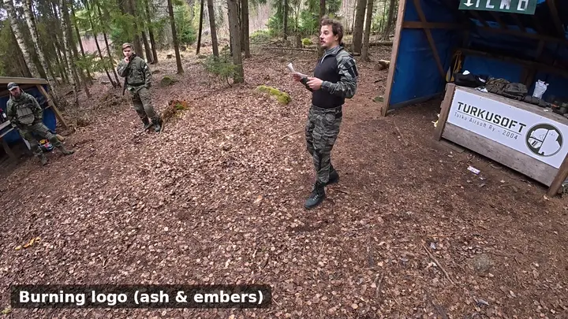 |
| **Smoke logo (smoke from the left)** | **Fire & smoke logo** |
| 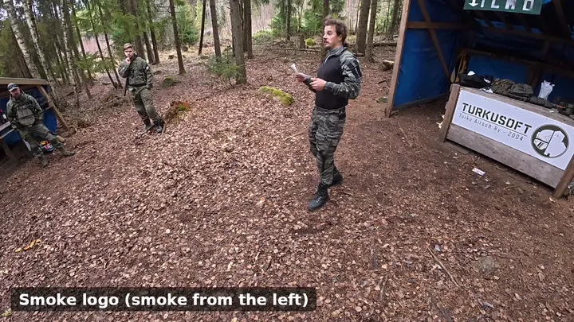 | 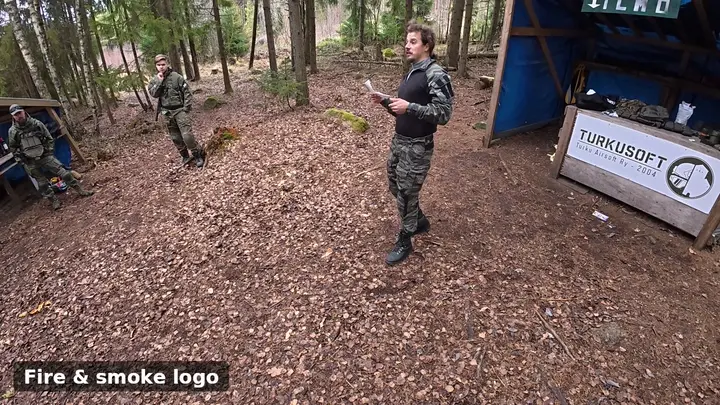 |

**Radio call card:** the clip's sound becomes walkie-talkie sound with clicks and static, a walkie-talkie slides in, radio-style subtitles and a static burst at each call.


**Friends' cameras (Video 2):** picture-in-picture, side by side, and switching to your friend's camera with a transition (one test clip plays as both cameras here).

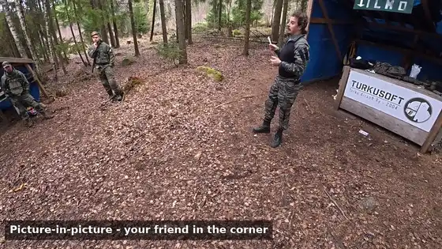

**Friends on the HUD:** each friend's heart rate and how far they are from you, and their dots on the map - from their own route / heart-rate files (GPX, TCX, a Health export). When you or a friend is hit, the heartbeat flatlines (a heart monitor with HIT and a long beep; their row and map dot go grey). Shown here with made-up example routes.

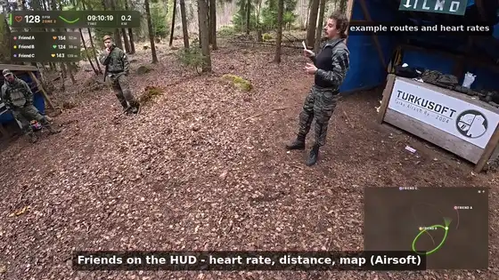

[▶ The friends preview as a video (MP4)](docs/previews/friends-preview.mp4)

**Transitions:** Luma melt, Lens flare wipe, Prism split, Warp zoom, Film roll, Cube turn, Water ripple


**Camera effects:** Anamorphic flares, Sun rays, Heat haze, Light leaks

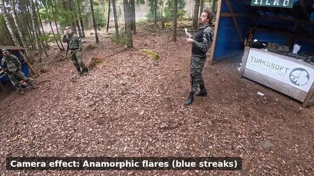

[▶ The whole preview as a video (MP4)](docs/previews/effects-preview.mp4)
<!-- avm-previews:end -->

## Starting it
- **Windows:** unzip, double-click `AVM.exe`. "Windows protected your PC" → More info → Run anyway (not signed).
- **Mac:** unzip, drag *AVM Swift* to Applications, right-click › Open the first time (not signed by Apple).
  If it says "damaged": `xattr -dr com.apple.quarantine "/Applications/AVM Swift.app"`

## Included in the Windows build
FFmpeg (GPL, gyan.dev builds — licence in the `ffmpeg` folder), a person-finder model from torchvision (BSD 3-Clause),
ONNX Runtime (MIT), fonts Inter, Lora, Share Tech Mono, Orbitron, Rajdhani (SIL Open Font License).
